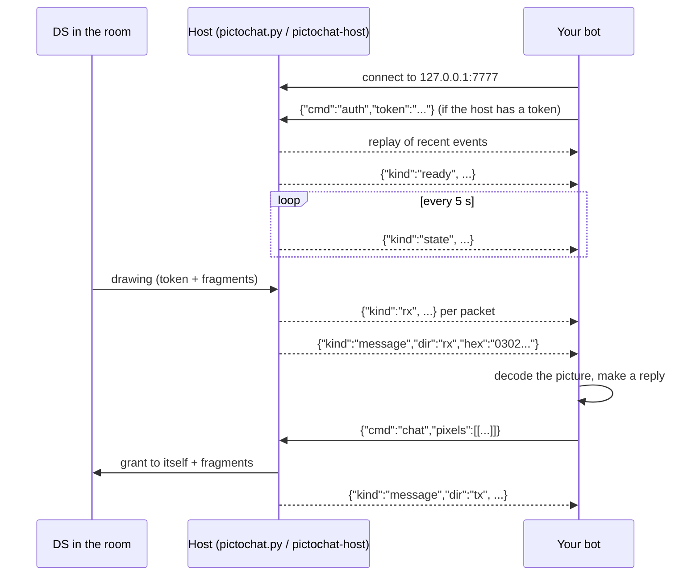

# Bot API: the host's JSON-lines port

Both hosts, `pictochat.py host` and `pictochat-host` (Rust), offer the same small API for your own programs: chatbots,
bridges to other rooms or chat systems, loggers. `pictochat_gui.py` and the Home Assistant integration
(`custom_components/pictochat/`) use it too.

- **Transport:** a TCP socket on `127.0.0.1:<port>`, enabled with `--gui-port 7777`. By default it listens on
  localhost only and has no authentication, so your program runs on the same machine.
- **From another machine or a container** (Python host, 0.3.0 and later): start the host with `--gui-bind 0.0.0.0`
  and a token, either `--gui-token TOKEN` or the `PICTOCHAT_TOKEN` environment variable. The host refuses to listen
  on another address than localhost without a token.
- **With a token**, the first line a client sends must be `{"cmd":"auth","token":"..."}`. Until then it receives
  nothing. A wrong or missing token is answered with `{"kind":"error","text":"authentication failed"}` and the
  connection is closed. The token and the traffic are not encrypted, so use this on a network you trust.
- **Format:** one JSON object per line (UTF-8, `\n`-terminated), in both directions.
- **Several clients at once:** the GUI and one or more bots can all be connected at the same time. Every client gets
  every event.
- **Replay:** when a client connects, it first receives the last 600 `log`, `rx`, `tx` and `message` events, so a late
  client can catch up. The Python host then sends one `ready` event: everything before it is history, everything
  after it is live. A bot that acts on messages should ignore the ones before `ready`. The Rust host has no `ready`
  yet; there the first `state` event, at most 5 s after connecting, marks the same point.
- **A slow reader gets dropped:** the host never blocks on a client. If your program stops reading, it is disconnected,
  and it should reconnect.



## Commands (your program → host)

| Command | Effect |
|---|---|
| `{"cmd":"auth","token":"..."}` | Must be the first line when the host has a token. Ignored otherwise. |
| `{"cmd":"chat","pixels":P}` | Sends a picture to the room. `P` is 80 rows of 256 palette indices (0-15; section 7 of `PROTOCOL.md`). Lines without ink are trimmed automatically. If no DS has joined yet, the message is held until one does. |
| `{"cmd":"set_name","name":"bot"}` | Sets the host's nickname, at most 10 characters. A DS sees the new name the next time it joins. |
| `{"cmd":"announce"}` | Sends the host's member message again (optionally with `"name"`). |
| `{"cmd":"raw","port":14,"hex":"...","repeats":6}` | Low level: puts a raw payload on a WM port (0xC, 0xD or 0xE). For experiments only. |
| `{"cmd":"mp_period","ms":7}` | With the ESP32 in `--offload` mode: changes the poll interval while the host runs. |

Unknown or malformed commands are answered with a `log` event that starts with `# gui:`.

**What a picture should look like:** the DS shows only columns 23-252 and rows 0-79, and the sender's name tab covers
columns 0-80 of rows 0-15. `pictochat_gui.py` has helpers you can import:
- `text_to_pixels(text, color=1)` renders text into a picture.
- `image_to_pixels(path, dither=True, invert=False, color=False)` turns an image file into a picture.
- `clip(rows)` blanks the invisible parts of a picture.

## Events (host → your program)

Every event has `kind` and `t`, which is the seconds since the host started.

| `kind` | Fields | Meaning |
|---|---|---|
| `message` | `id`, `hex`, `dir` | A **complete message**. `dir` is `"rx"` when it came from a DS (`id` is the DS's AID) and `"tx"` when the host sent it (`id` is 0). `hex` is the whole message (section 7 of `PROTOCOL.md`). |
| `state` | `version`, `commit`, `impl`, `radio`, `uptime`, `aids`, `cmd`, `replies`, `beacons`, `cycle`, `reply_age`, `rssi` | Sent every 5 s. `version` is the host's version, `commit` the short git commit of the running code (empty if unknown), `impl` is `python` or `rust`, `radio` describes the radio in words and `uptime` is the seconds since the host started. `aids` maps the MAC of each associated DS to its AID. `rssi` maps a MAC to `[last dBm, smoothed dBm, seconds since heard, frames]`. `reply_age` is the seconds since any DS last answered a poll. |
| `rx` | `port`, `ptype`, `hex`, `mac` | One port packet from a DS (low level). |
| `tx` | `port`, `ptype`, `hex`, `repeats` | One port packet the host sent (low level). |
| `log` | `text` | A host log line, such as `# client 1 joined` or `# gui: ...`. |
| `ready` | `version` | The replay is over; the events that follow are live (Python host). |
| `error` | `text` | The token was refused. The host closes the connection. It has no `t`. |

**The messages you'll care about** (decode `bytes.fromhex(ev["hex"])`):
- `03 02 ...` is a **chat picture**. `pictochat_gui.decode_image(msg)` returns 80 rows of 256 palette indices (or
  `None`).
- `03 00` and `03 01` are **member messages**: a DS joining or ready. The nickname is UTF-16LE in bytes 8-27, so
  `msg[8:28].decode("utf-16-le").rstrip("\0")` gives it. Use them to greet people.
- A DS leaving shows up as its MAC disappearing from `state.aids`.

## A minimal bot

[`examples/echo_bot.py`](examples/echo_bot.py) answers every picture from a DS with a short text and sends the picture
back. It is about 40 lines of standard-library code plus `pictochat_gui.py`.

```
sudo .venv/bin/python pictochat.py host --iface <wifi-interface> --channel 1 --gui-port 7777
.venv/bin/python examples/echo_bot.py 7777
```

If the host has a token, give the bot the same one: `PICTOCHAT_TOKEN=... .venv/bin/python examples/echo_bot.py 7777`.
`pictochat_gui.py` and `emu/sendchat.py` read `PICTOCHAT_TOKEN` in the same way.

Any language that can open a TCP socket and read JSON works the same way.

## Is there a REST or HTTP API?

No. A REST API fits poorly here because the room pushes events: you would have to poll for new messages. The JSON-lines
socket delivers them as they arrive, and with `--gui-bind` and a token it is reachable from other machines. If you
need HTTP, WebSockets or encryption, put a small proxy in front of this port.
