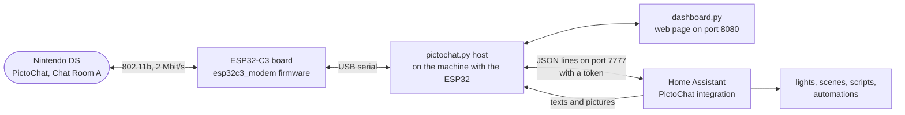
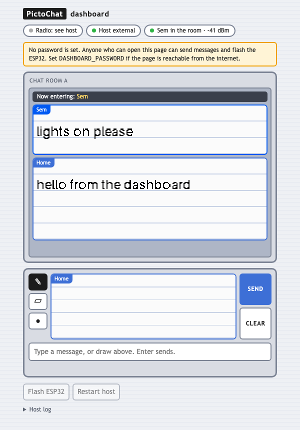

# PictoChat for Home Assistant

Use a Nintendo DS as a remote control for your home. Type `lights on` in PictoChat, press send, and Home Assistant
runs the action you linked to it. Home Assistant can answer: it sends texts and pictures back to the DS, so a doorbell
or a finished washing machine shows up in the chat room.

- **`dashboard.py`** is a web page in PictoChat style. It shows the room, sends drawings and texts, and flashes the
  ESP32-C3. It is what the Docker deployment runs.
- **`pictochat.py`** is the host. It keeps a PictoChat room open for the DS and gives other programs an API.
- **`custom_components/pictochat/`** is the Home Assistant integration: phrases, actions, entities and services.
- **`esp32c3_modem/`** is firmware that turns an ESP32-C3 board into the host's radio, and **`firmware/`** is a
  ready build of it.
- **`Dockerfile`** and **`docker-compose.yml`** deploy all of it, for example in Coolify.
- **[`PROTOCOL.md`](PROTOCOL.md)** explains how PictoChat works on the air, and **[`API.md`](API.md)** describes the
  host's API.

This is a fork of [LNYmachines/pictochat-host](https://github.com/LNYmachines/pictochat-host), which worked out the
protocol and wrote the host. The fork adds the Home Assistant integration and the network access it needs.

**Status:** the host was measured on a real DS Lite by the original project. The dashboard and the integration are
tested against the host's API with simulated DS messages (the integration in Home Assistant 2026.10, see `tests/`).
They have not yet run with a real DS and ESP32-C3 from end to end.


## How it fits together



## What you need

- **A Nintendo DS, DS Lite or DSi.** PictoChat is built in.
- **An ESP32-C3 board with native USB** (a few euros). It is the radio, and there is no way around a radio: a
  container has none, and a computer's own Wi-Fi cannot do this job. The DS speaks Nintendo's multiplay protocol over
  802.11b, which needs raw frames with a chosen sender address, and macOS and normal Wi-Fi drivers do not allow that. On Linux a monitor-mode USB adapter also works (see
  [Other radios](#other-radios)).
- **A computer with a USB port within a few metres of the DS.** A Mac or any Linux machine. It runs the host.
- **Home Assistant.** It may run anywhere that can reach the host over the network, including a container on the same
  machine.

## Setup

### 1. Deploy the dashboard

The repository is one Docker Compose app: a dashboard, the host and a flasher for the ESP32-C3.

- **In Coolify:** add the repository as a **Docker Compose** resource, set the environment variable
  `DASHBOARD_PASSWORD`, give the service a domain on port 8080 and deploy.
- **With plain Docker:** `DASHBOARD_PASSWORD=choose-one docker compose up -d --build`, then open
  `http://<machine>:8080`.

The page asks for the password; any user name works. Plug the ESP32-C3 into the machine that runs Docker.

- **On Linux** the container finds the board by itself.
- **On a Mac with OrbStack 2.2 or later**, OrbStack forwards serial ports that are plugged into the Mac to Linux
  ([OrbStack docs: USB devices](https://docs.orbstack.dev/features/usb)). Check with `orb serial list`. If the
  dashboard still says **No ESP32 found**, hand the board to Linux completely with `orb usb list` and
  `orb usb attach <id>`. If its port is not named `/dev/ttyACM*` or `/dev/ttyUSB*`, set `PICTOCHAT_SERIAL` to its
  name. This route is not tested with an ESP32-C3 yet: OrbStack's list of tested serial devices names USB-to-UART
  chips, not the ESP32-C3's built-in USB port.
- **Docker Desktop on a Mac** does not pass USB devices to containers. Use the
  [service without Docker](#without-docker) there.
- The container runs `privileged` and sees the machine's `/dev`, so that it finds the board whenever it is plugged
  in. `docker-compose.yml` shows a stricter setting for Linux.

Other settings: `PICTOCHAT_CHANNEL` (1), `PICTOCHAT_ROOM` (0-3 = A-D), `PICTOCHAT_NAME` (the nickname on the DS) and
`PICTOCHAT_SERIAL`.

### 2. Flash the ESP32-C3 from the dashboard

Press **Flash ESP32** and confirm. The dashboard stops the host, writes the firmware in `firmware/` to the board and
starts the host again. This is needed once per board.

- If the board does not answer, put it in download mode: hold BOOT, press RESET, release BOOT. Then flash again.
- `firmware/` holds a build of `esp32c3_modem/`. `firmware/build.sh` rebuilds it in Docker.

### 3. Test from the dashboard



On the DS, open PictoChat and choose **Chat Room A**. Then:

- The pill at the top shows the DS and its signal strength, and the room shows **Now entering**.
- Messages from the DS appear in the room as you send them.
- Draw in the box at the bottom or type a text, and press **SEND**. The DS shows it.
- **Host log** shows what the host does, and **Restart host** starts it again.

### 4. Later: connect Home Assistant

The integration talks to the host's API on port 7777. Set `PICTOCHAT_TOKEN` in the deployment to open that port
with a token, and deploy again.

- **With HACS:** open HACS, choose **Custom repositories**, add `https://github.com/SemSannen-NB/pictochat-host` as
  an **Integration**, and install **PictoChat (Nintendo DS)**.
- **By hand:** copy the folder `custom_components/pictochat` into the `custom_components` folder of your Home
  Assistant configuration (create it if it does not exist). In a container that is `/config/custom_components/`.

Restart Home Assistant. Then go to **Settings > Devices & services > Add integration**, pick **PictoChat** and enter
the IP address of the machine that runs the container, port 7777 and the token.

### Teach it your phrases

A DS does not send text. It sends a picture of 256 × 80 pixels, and typed letters are part of that picture. So Home
Assistant learns each phrase from an example:

1. Type the phrase on the DS, for example `lights on`, and send it.
2. In Home Assistant, open the PictoChat integration and choose **Configure > Learn a phrase from the last DS
   message**.
3. Give it a name and, if you like:
   - **entities to run it on** (lights, switches, fans, helpers, scripts, scenes, buttons) and whether to toggle them,
     turn them on or turn them off;
   - **an answer** that the DS gets back, such as `OK!`.
4. Send the same message again. The action runs.

Good to know:

- **Typed text is matched exactly.** The DS stamps the same letters as the same pixels, wherever they are in the
  message. `lights on`, `Lights on` and `lights on!` are three different phrases.
- **One phrase can have several examples.** Learn a message under a name that already exists to add it, for instance
  for a second spelling.
- **Drawings match only roughly.** A drawing never comes out the same twice. To try it, lower **How exactly a message
  must match** under **Configure > Settings** and teach a few examples of the drawing. Expect misses.
- **The same message cannot mean two phrases.** Home Assistant refuses to learn it a second time.
- After a restart or reconnect, old messages are never acted on again.

### Without Docker

**As a service on a Mac.** This runs the host only, without the dashboard:

```
git clone https://github.com/SemSannen-NB/pictochat-host.git && cd pictochat-host
deploy/macos/install.sh
```

- The script installs the host as a background service of your user. It starts at login and restarts when it stops.
- It prints the **host, port and token** for Home Assistant. They are also in
  `~/Library/Application Support/pictochat-host/config.env`, together with the channel, the room and the nickname.
  From a container on the same Mac, the host to enter in Home Assistant is `host.docker.internal`.
- Errors go to `~/Library/Logs/pictochat-host.log`. Without an ESP32 the service waits and looks again every 15 s.
- The service runs while your user is logged in. On a server, turn on automatic login.
- `deploy/macos/install.sh --uninstall` removes the service.

**By hand, on any machine,** with the dashboard:

```
python3 -m venv .venv && .venv/bin/pip install pyserial esptool
.venv/bin/python dashboard.py            # then open http://localhost:8080
```

The settings are the environment variables listed at the top of `dashboard.py`. To run only the host, see
[`pictochat.py`](#pictochatpy) below.

## What you get in Home Assistant

| Entity | What it shows |
|---|---|
| `binary_sensor.pictochat_ds_in_room` | On while a DS is in the room. Attributes: how many, and their nicknames. |
| `sensor.pictochat_last_phrase` | The phrase that the last message matched, or unknown. Attributes: sender and score. |
| `image.pictochat_last_message` | The last picture a DS sent, in PictoChat's colours. |
| `event.pictochat_message` | Fires for every message: `phrase` or `unknown`. |
| `notify.pictochat_room` | Sends a notification text into the room. |
| `sensor.pictochat_ds_signal` | Signal strength of the DS (diagnostic). |

**Triggers for automations**

- **Device triggers:** in the automation editor, choose the PictoChat device. It offers one trigger per phrase and
  one for a message that matched nothing.
- **Events:** `pictochat_phrase` fires for a recognised phrase and `pictochat_message` for every message. Both carry
  `phrase`, `sender`, `sender_mac`, `score` and `recognized`.

```yaml
automation:
  - alias: "Good night from the DS"
    trigger:
      - platform: event
        event_type: pictochat_phrase
        event_data:
          phrase: good night
    action:
      - service: scene.turn_on
        target:
          entity_id: scene.night
```

**Actions**

- `pictochat.send_text` sends `message` in ink `color` 1-15. A long text is split over up to three messages.
- `pictochat.send_image` sends the image file at `path`, fitted to 230 × 64 pixels, with `dither` and `color`
  options. The path must be inside `allowlist_external_dirs`.
- `notify.send_message` on `notify.pictochat_room` does the same as `send_text`.

```yaml
automation:
  - alias: "Doorbell on the DS"
    trigger:
      - platform: state
        entity_id: binary_sensor.doorbell
        to: "on"
    action:
      - service: pictochat.send_text
        data:
          message: "Someone is at the door!"
```

A message sent while no DS is in the room is held by the host until one joins.

## Troubleshooting

- **The dashboard says No ESP32 found.** See step 1 for the Mac. On Linux, check `ls /dev/ttyACM*`.
- **The host runs but the DS does not see the room** right after plugging in a new board: flash it first (step 2).
- **The integration cannot connect.** Check that `PICTOCHAT_TOKEN` is set in the deployment, that the port is 7777
  and that a firewall does not block it.
- **The token is refused.** Copy it again from `PICTOCHAT_TOKEN`.
- **The DS does not list the room.** The radio is too far away, or the PictoChat channel is the one your own Wi-Fi
  uses. Move your own Wi-Fi to another channel first. Room A on channel 1 is the only combination confirmed on a real
  DS; other values of `PICTOCHAT_CHANNEL` are an experiment.
- **A phrase does not fire.** Look at `image.pictochat_last_message` and at the score of
  `sensor.pictochat_last_phrase`. A different capital letter or an extra space at the start makes another picture.

## Other radios

The ESP32-C3 is the route this fork is set up for. The host also works with a monitor-mode Wi-Fi adapter on Linux:

| Radio | Notes |
|---|---|
| **ESP32-C3 on USB** (recommended) | Any ESP32-C3 board with native USB (USB Serial/JTAG). Flash `esp32c3_modem/`. With `--offload` the ESP32 runs the poll loop itself: 100-143 polls/s, 91-96 % answered. |
| **Nintendo Wi-Fi USB Connector** (Ralink RT2570) | Works as is in monitor mode. About 76 polls/s from Python. |
| Other monitor-mode adapters | They must inject at **2 Mbit/s**, because the DS ignores polls sent at 1 Mbit/s. Atheros AR9271 (`ath9k_htc`) sends injected frames at 1 Mbit/s unless its firmware is patched. |

With an adapter, start the host as root with `--iface <wifi-interface>` instead of `--serial ... --offload`. Find the
interface name with `iw dev`.

## The host and its tools

These come from the original project and work without Home Assistant too.

### `pictochat.py`

- **`host`** runs the PictoChat host.
  - Room options: `--iface` or `--serial`, `--channel` (1 for room A), `--room` (0-3 = A-D), `--mac` (also set on the
    adapter), `--name` (the nickname shown on the DS, at most 10 characters) and `--color` (0-15).
  - Pace and delivery: `--poll-ms` (5), `--reply-wait` (4 ms), `--poll-cycle` and `--poll-cycle-joined` (1 / 1),
    `--hello-repeats` (8, the most copies sent of any packet) and `--no-confirm`. `PROTOCOL.md` section 9 explains the
    delivery rule.
  - ESP32 options: `--offload` and `--mp-period-ms` (7).
  - Output: `--out` (base name for the log and pcap, default `host_log`; `--out none` writes no files) and `--all`.
  - API: `--gui-port 7777` opens the JSON-lines API on `127.0.0.1`. `--gui-bind 0.0.0.0` opens it to other machines
    and then requires `--gui-token TOKEN` (or the `PICTOCHAT_TOKEN` environment variable). See [`API.md`](API.md).
  - Testing: `--bridge PORT --lockstep` (emulator), `--dry-run PCAP` and `--seed`.
  - The log shows each protocol step, every frame from the DS and a status line every 5 s.
- **`capture`** sniffs a real room. It hops channels until it hears a DS, then writes a pcap and a decoded log. Type a
  label and press Enter to drop a marker into the log.
- **`analyze`** decodes a pcap.
- **`selftest`** checks the frame builders against known bytes.
- The protocol code lives in the I/O-free class `MultiplayHost` and in helpers such as `member_info_message`,
  `chat_message`, `bitmap_to_image`, `fragments`, `type1_payload`, `gameinfo`, `build_cmd` and `build_ack`.

### `pictochat_gui.py`

- **Sending:**
  - A text box with **Send text** renders the text into a picture.
  - A 256×80 canvas with **Send drawing** sends what you drew. Greyed-out areas are not shown by the DS and are
    clipped.
  - **Load image...** fits a picture file into the visible area (230 × 64 px) and dithers it with Floyd-Steinberg to
    black and white, or to the 16-colour palette when **colour** is ticked.
- A row of pen colours, with all 15 ink colours.
- A packet list with a hex dump for each packet. Received drawings are shown as pictures.
- A command line with `say`, `draw`, `clear`, `pen`, `line`, `raw <port> <hex>`, `image <file>`, `save` and `help`.
- **The GUI port** is a JSON-lines protocol. Other programs use it too: the Home Assistant integration, a chatbot or
  a bridge to another room. They receive the room's packets and events, and they send messages. See
  [`API.md`](API.md). If the host has a token, start the GUI with `PICTOCHAT_TOKEN=... .venv/bin/python pictochat_gui.py`.
- It needs Tk. On Debian, Ubuntu or Mint: `sudo apt install python3-tk`.

### `esp32c3_modem/` (ESP-IDF 5.4)

You need ESP-IDF 5.4. Install it with Espressif's
[Linux setup guide](https://docs.espressif.com/projects/esp-idf/en/v5.4.1/esp32c3/get-started/linux-macos-setup.html)
(`git clone -b v5.4.1 --recursive https://github.com/espressif/esp-idf.git ~/esp/esp-idf`, then
`~/esp/esp-idf/install.sh esp32c3`). Then, in every new terminal:

```
. ~/esp/esp-idf/export.sh            # puts idf.py on the PATH
cd esp32c3_modem
idf.py set-target esp32c3            # once
idf.py build flash -p /dev/ttyACM0
```

On macOS the port is `/dev/cu.usbmodem...` (find it with `ls /dev/cu.usbmodem*`) and the same guide covers the
install.

A board that doesn't flash may need download mode: hold BOOT, press RESET, then release BOOT.

- The modem moves raw frames between USB and the air. It sends at a fixed 2 Mbit/s with the long preamble, and it
  receives in promiscuous mode with an on-chip filter. Its station MAC is set to the host MAC, so the hardware ACKs the
  DS.
- ESP-IDF refuses to send auth and assoc responses with `esp_wifi_80211_tx`. Its sanity check is therefore replaced at
  link time (`-Wl,-zmuldefs`).
- USB framing is `AA 55 | type | u16 len | payload | xor8`. The message types are listed in `modem.c`.
- **Plain mode** (`--serial`): the PC builds every frame, polling included. That gives about 50 polls/s.
- **Offload mode** (`--offload`): the ESP32 runs the poll / reply / ACK cycle itself, and the PC only pushes and
  receives PictoChat packets. Measured with a real DS:

  | Poll interval | Polls/s | Answered |
  |---|---|---|
  | 20 ms | 50 | 92 % |
  | 10 ms | 100 | 96 % |
  | 7 ms (default) | 143 | 91 % |
  | 5 ms | 200 | 79 % |

  At 2.5 ms the DS never answered, and beacon TX failed with `ESP_ERR_NO_MEM`. Keep the PictoChat channel away from
  the channel your own Wi-Fi uses.

### `host_rs/` (Rust host for the ESP32 offload mode)

- It has the same JSON-lines GUI port as the Python host, and its packets are byte-for-byte equal to the Python
  builders, which a unit test checks.
- It does not have `--gui-bind` and `--gui-token` yet, so it serves programs on the same machine only. For Home
  Assistant on another machine or in a container, use the Python host.
- It assembles a message only once every byte has arrived.
- On a Pi Zero 2 W with a DS in the room it uses 0.5 % CPU and 1 MB RAM. The Python host uses 1.7 % and 15 MB.
- You need Rust: install it with [rustup](https://rustup.rs).
- Build: `cd host_rs && cargo build --release`. The binary is `target/release/pictochat-host`.
- For 32-bit Raspberry Pi OS without an ARM cross-compiler, run `rustup target add armv7-unknown-linux-musleabihf`
  once, then `cargo build --release --target armv7-unknown-linux-musleabihf`. This links statically against musl
  using rust-lld. Copy `target/armv7-unknown-linux-musleabihf/release/pictochat-host` to the Pi.
- Options: `pictochat-host --help`.

### `emu/`: two-DS emulator test bed

This is the safe place to try protocol changes. It runs two emulated DS Lites on the real firmware, either talking to
each other or to our host through a TCP bridge.

- **Build tools:** git, cmake, g++ and unzip. On Debian, Ubuntu or Mint: `sudo apt install git cmake g++ unzip`.
- **BIOS and firmware:** you need your own dumps of `bios7.bin`, `bios9.bin` and `firmware.bin` from a DS Lite. They
  are Nintendo's copyrighted code and are not included. Either copy the three files into `emu/fw/`, or pass a zip that
  contains them to `build.sh`.
- `cd emu && ./build.sh ["path/to/zip"]` clones melonDS at commit `497aa6cd`, then builds its core, the harness and
  `romrun`. It takes a few minutes.
- `./start.sh OUT.pcap 2` runs two DSes that chat with each other, which gives reference traffic.
  `./start.sh OUT.pcap 1 7778` runs one DS whose host side is a bridge for
  `pictochat.py host --bridge 7778 --lockstep`.
- **First run:**
  1. Run `./start.sh first.pcap 2`.
  2. Tap the screens with `./ctl.sh "touch 0 5 5 6" "touch 1 5 5 6"`.
  3. If the DSes show the setup wizard (a firmware without user settings), run `./wizard.sh`. It completes the wizard
     on both DSes.
  4. Check with `./shot.sh 0 menu`, which writes `menu.png`. The DS menu should show PictoChat.
- **Controlling the emulator:**
  - `./ctl.sh "cmd"` accepts `touch I X Y [frames]`, `drag`, `key I MASK frames`, `shot I file.ppm`, `reset I`,
    `fps N`, `fast on|off` and `quit`.
  - `./shot.sh I name` saves a PNG screenshot.
  - `python3 viewer.py 2` opens a live window; click the lower screen to tap it.
- **A full bridged session:** `FPS=60 ./exp.sh TAG --lockstep` starts one emulated DS and the host, joins room A and
  reports the join and the emulation speed. `./run_bridge.sh TAG [host args]` does the same without the report.
  The host's GUI port is 7790, so `../.venv/bin/python sendchat.py 7790 "text"` sends text, and
  `../.venv/bin/python ../examples/echo_bot.py 7790` runs the example bot. Both need Pillow, so use the venv.
  The live host log is `TAG.log`. To run a second checkout at the same time, give it its own ports:
  `BRIDGE_PORT=7878 GUI_PORT=7890 ./exp.sh TAG --lockstep`.
- **Draw and send on the emulated DS:** `./ctl.sh "drag 0 100 45 200 80 30"` draws a line, and
  `./ctl.sh "touch 0 238 116 8"` presses SEND. A stroke must start below the nickname tab in the top-left corner of
  the drawing area, or PictoChat ignores it. The host log then shows `DS message complete`; at emulator speed this
  can take half a minute.
- **Stop everything:** `./stop.sh`. It stops only the harness and host that these scripts started.
- **Analysis:** `flow.py PCAP t0 t1 [--no-fcs]` prints a compressed packet flow, and `early.py PCAP N` lists the frames
  after association.
- **Pitfalls:**
  - The emulator does not advance time while it waits for the bridge, so use `--lockstep`.
  - A one-instance harness must not be sent commands for instance 1.
- `romrun.cpp` is a headless runner for homebrew `.nds` files: scripted keys, touch input, screenshots and an emulated
  SD folder.

## Running on the real DS

- After a host restart, a DS that is still in the room sends a few deauths, then rejoins within about 2 s.
- If the host was away for longer, the DS opens the room itself and stays there alone. Leave the room on the DS and
  enter it again to get back to the host.
- Only one host can use a modem. A second one on the same serial port is refused. If the host runs as a service,
  stop the service before starting another host by hand.
- If the DS drops out, try `--poll-ms 10` or `--no-confirm`. A frozen DS needs a power cycle.
- Logs: `host_log.log` and `host_log.pcap`. Wireshark opens the pcap, and `pictochat.py analyze` decodes it. Captures
  contain the real MAC addresses of your devices, so think twice before publishing them.

## Tests

```
python3 pictochat.py selftest                       # the host's frame builders, no hardware needed
python3 -m venv .venv && .venv/bin/pip install pytest-homeassistant-custom-component pillow
.venv/bin/python -m pytest                          # the integration, in a real Home Assistant, against the host's API
```

## License

GPLv3 (see `LICENSE`), like the original project. `emu/harness.cpp` and `emu/romrun.cpp` link against melonDS, which is GPLv3 as well.
PictoChat and Nintendo DS are trademarks of Nintendo. This project is not affiliated with or endorsed by Nintendo.
